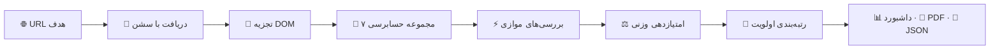

# 🔍 RankPilot

🌐 **زبان / Language:** [English](README.md) | **فارسی**

> حسابرس داده‌محور سئو و فنی وب‌سایت. موتور امتیازدهی دترمینیستیک، خزنده هم‌روند و Core Web Vitals واقعی از PageSpeed Insights گوگل — خالص پایتون به‌علاوه یک API رایگان گوگل.

**🚀 دموی زنده:** https://rankpilot-wvugccwcscig6wdpe2pqiq.streamlit.app/


---

## ✨ قابلیت‌ها — نسخه Enterprise

| قابلیت | جزئیات |
|---------|---------|
| 🔍 حسابرسی ۷ دسته‌بندی | متا، هدینگ‌ها، تصاویر، لینک‌ها، عملکرد، امنیت، محتوا — ۲۵ چک |
| 🌐 حسابرسی چندصفحه‌ای سایت | کرال مبتنی بر سایت‌مپ — نمره تجمیعی، میانگین دسته‌بندی‌ها، ضعیف‌ترین صفحات |
| 🆚 مقایسه با رقیب | همان پایپ‌لاین برای هر دو سایت — دلتای نمره/دسته‌بندی، فرصت‌های رتبه‌بندی‌شده |
| ⚡ Core Web Vitals | LCP / INP / CLS واقعی از PageSpeed Insights (اول موبایل) — رأی داده میدانی، تشخیص lab، ۳ فرصت برتر |
| 💯 امتیازدهی دترمینیستیک | ۰ تا ۱۰۰ با وزن‌های شفاف — بدون جعبه سیاه |
| ⚡ خزنده هم‌روند | `ThreadPoolExecutor` — بررسی لینک‌ها و تصاویر به‌صورت موازی |
| 📱 پروفایل‌های دستگاه | دسکتاپ Chrome 128 · موبایل iPhone Safari · Googlebot |
| 🎓 گرید حروفی | A (۹۰+) تا F (زیر ۶۰)، با زیرنمره هر دسته‌بندی |
| 📊 تحلیل راداری | نمودار قطبی Plotly + جدول توزیع دسته‌بندی‌ها |
| 🎯 پلن اقدام اولویت‌دار | خطاها مرتب‌شده بر اساس وزن × شدت — اول چیزی را درست کنید که اثر دارد |
| 📄 خروجی PDF | گزارش حسابرسی آماده ارائه به کارفرما با یک کلیک (ReportLab) — حالا شامل Core Web Vitals |
| 💾 خروجی JSON | داده خام ساخت‌یافته برای پایپ‌لاین‌ها و تیم‌های سئو — حالا شامل Core Web Vitals |
| 🌙 رابط تیره پرمیوم | داشبورد تب‌بندی‌شده Streamlit با CSS اختصاصی |
| 🐳 آماده داکر | Dockerfile و docker-compose برای استقرار با یک دستور |

---

## 🧠 منطق علمی — موتور حسابرسی چطور کار می‌کند

رنک‌پایلت حدس نمی‌زند — *اندازه می‌گیرد*. هر حسابرسی دقیقاً یک پایپ‌لاین دترمینیستیک را اجرا می‌کند: یک URL یکسان، همیشه یک نمره یکسان. بدون جعبه سیاه یادگیری ماشین، بدون هیوریستیک مرموز.

### پایپ‌لاین



### ۱. 📡 دریافت مبتنی بر سشن
یک `requests.Session` ماندگار (استخر اتصال، یوزرایجنت واقعی دسکتاپ) هدف را با تایم‌اوت ۱۰ ثانیه‌ای دریافت می‌کند. مدیریت خطای تایپ‌شده، خطاهای SSL، تایم‌اوت و DNS را از هم جدا می‌کند — هر کدام به‌صورت یک پیام واضح نمایش داده می‌شوند، نه تریس‌بک. پاسخ‌های غیر HTML *قبل* از تجزیه رد می‌شوند، پس لینک یک PDF هرگز حسابرسی بی‌معنی تولید نمی‌کند.

### ۲. 🔬 تجزیه واحد DOM
BeautifulSoup به‌همراه `lxml` درخت سند را **فقط یک بار** می‌سازد. هر هفت مجموعه حسابرسی از همان درخت می‌خوانند — بدون دریافت مجدد، بدون تجزیه مجدد، بدون اتلاف.

### ۳. 🧪 هفت مجموعه حسابرسی — ۲۵ چک
هر چک یک تابع خالص است که امتیاز `کسب‌شده / سقف`، یک یافته و یک توصیه عملی برمی‌گرداند:

- **متا و هد (۲۰ امتیاز)** — طول تایتل ۳۰ تا ۶۰ کاراکتر، متا دیسکریپشن ۱۲۰ تا ۱۶۰ کاراکتر، ویوپورت، charset، سه‌تایی Open Graph، URL کنونیکال
- **هدینگ‌ها (۱۵ امتیاز)** — دقیقاً یک H1، بدون پرش سطح هدینگ، هدینگ‌های غیرخالی، طول H1 بین ۲۰ تا ۷۰ کاراکتر
- **تصاویر (۱۵ امتیاز)** — پوشش alt-text، عرض/ارتفاع صریح (جلوگیری از پرش چیدمان CLS)، وزن فایل زیر ۱ مگابایت با بررسی سبک HEAD
- **لینک‌ها (۱۵ امتیاز)** — اسکن لینک خراب با fallback از HEAD به GET برای CDNهایی که HEAD را بلاک می‌کنند، کیفیت انکرتکست، `rel="noopener/nofollow"` روی لینک‌های خارجی
- **عملکرد (۱۵ امتیاز)** — HTML زیر ۱۰۰ کیلوبایت، حداکثر ۸ اسکریپت خارجی، حداکثر ۴ استایل‌شیت، تشخیص فشرده‌سازی gzip/Brotli
- **امنیت (۱۰ امتیاز)** — اجبار HTTPS، اسکن محتوای ترکیبی (mixed-content)
- **محتوا (۱۰ امتیاز)** — بیش از ۳۰۰ کلمه، ساختار H2، میانگین طول جمله به‌عنوان شاخص خوانایی

### ۴. ⚡ مدل هم‌روندی
اعتبارسنجی لینک‌ها (تا ۱۵ هدف) و بررسی وزن تصاویر (تا ۱۰ تصویر) در استخرهای اختصاصی `ThreadPoolExecutor` اجرا می‌شوند — ۸ ورکر برای لینک‌ها، ۵ ورکر برای تصاویر. کاری که ترتیبی حدود ۷۵ ثانیه طول می‌کشید، در حدود ۱۰ ثانیه تمام می‌شود. سشن‌ها بین تردها مشترک‌اند (استخر اتصال) و هر پاسخ استریم‌شده به‌درستی بسته می‌شود.

### ۵. ⚖️ امتیازدهی دترمینیستیک
هر چک بر اساس آستانه‌های منتشرشده **نمره کامل / جزئی / صفر** می‌گیرد — مثلاً تایتل ۳۰ تا ۶۰ کاراکتر = ۶ امتیاز، موجود ولی خارج از بازه = ۳، ناموجود = صفر. بازه‌های وضعیت: **pass** بالای ۸۰٪، **warn** بین ۴۰ تا ۷۹٪، **fail** زیر ۴۰٪. گریدها از A (۹۰+) تا F (زیر ۶۰) نگاشت می‌شوند. جدول وزن‌ها کنار هر نمره در رابط کاربری نمایش داده می‌شود — عدد کاملاً قابل حسابرسی است، نه جادو.

### ۶. 🎯 رتبه‌بندی اولویت
هر چک فیل‌شده یا هشدارگرفته بر اساس `وزن دسته‌بندی × شدت` رتبه‌بندی می‌شود (fail = ۲، warn = ۱). بنابراین پلن اقدام، اصلاحات را به ترتیب *امتیاز قابل بازگشت* فهرست می‌کند — ارزشمندترین کاری که صاحب سایت می‌تواند اول انجام دهد.

### ۷. 📱 پروفایل‌های دستگاه
سه پروفایل یوزرایجنت — **دسکتاپ Chrome 128**، **موبایل iPhone Safari**، **Googlebot** — چون چیزی که کاربر می‌بیند، چیزی که گوشی می‌بیند و چیزی که گوگل می‌بیند، سه حسابرسی متفاوت‌اند. لنز را قبل از اسکن انتخاب کنید.

---

## 🏗️ معماری

موتور کاملاً از رابط کاربری جداست — بدون نیاز به Streamlit، هرجا ایمپورتش کنید:

```
rankpilot/
├── app.py              → داشبورد Enterprise با Streamlit (رابط کاربری، نمودارها، خروجی‌ها)
├── core/
│   ├── __init__.py
│   ├── models.py       → دیتاکلس‌های AuditCheck / AuditReport / SiteAuditReport
│   ├── engine.py       → RankPilotEngine: دریافت، حسابرسی، امتیازدهی، کرال سایت
│   ├── sitemap.py      → کشف دترمینیستیک /sitemap.xml
│   ├── compare.py      → موتور مقایسه با رقیب (M2)
│   └── cwv.py          → Core Web Vitals از طریق PageSpeed Insights API (M3)
├── requirements.txt
├── Dockerfile
└── docker-compose.yml
```

```python
from core.engine import RankPilotEngine
from core.cwv import run_cwv

# تک‌صفحه
report = RankPilotEngine().inspect_url("https://example.com")
print(report.total_score, report.letter_grade)   # 70.5 C

# کل سایت — کرال حداکثر ۲۵ صفحه از طریق /sitemap.xml
site = RankPilotEngine().audit_site("https://example.com", max_pages=25)
print(site.avg_score, site.grade, site.page_count)

# Core Web Vitals (اول موبایل) — نیازمند کلید رایگان PageSpeed API
cwv = run_cwv("https://example.com", api_key="YOUR_KEY")
print(cwv.metrics["lcp"].verdict, cwv.metrics["cls"].field_percentile)
```

**جریان داده:** `URL ← RankPilotEngine.inspect_url() ← AuditReport ← داشبورد / PDF / JSON` و `URL ← run_cwv() ← CWVResult ← تب CWV / PDF / JSON`.
دیتاکلس `AuditReport` تنها مرجع حقیقت است — داشبورد، تولیدکننده PDF و خروجی JSON همگی از آن مشتق می‌شوند.

---

## 🌐 ماژول M1 — حسابرسی چندصفحه‌ای سایت: منطق علمی

نمره تک‌صفحه می‌گوید یک URL چطور عمل می‌کند. نمره *سایت* می‌گوید کل دارایی چطور عمل می‌کند — و مهم‌تر از آن، *کجا خون‌ریزی دارد*. ماژول M1 موتور دترمینیستیک را بدون تغییر هیچ قاعده امتیازدهی، از یک URL به کل سایت‌مپ گسترش می‌دهد: هر صفحه با دقیقاً همان پایپ‌لاین ۲۵ چکی حسابرسی می‌شود، پس نمره صفحات مستقیماً قابل مقایسه‌اند.

### ۱. 🗺️ کشف سایت‌مپ (`core/sitemap.py`)
کرالر `/sitemap.xml` را دریافت و به‌صورت XML تجزیه می‌کند (با fallback رگ‌اکس برای فیدهای خراب). فایل‌های **ایندکس** سایت‌مپ به‌صورت بازگشتی دنبال می‌شوند — سایت‌مپ‌های فرزند در صف قرار گرفته و اول‌سطح کرال می‌شوند. هر URL کشف‌شده نرمال‌سازی شده، به **همان دامین قابل ثبت** فیلتر می‌شود (ساب‌دامین‌ها و URLهای خارجی حذف می‌شوند)، تکراری‌زدایی شده و به سقف `max_pages` (پیش‌فرض ۲۵) محدود می‌شود. اگر سایت‌مپی وجود نداشته باشد یا قابل تجزیه نباشد، حسابرسی با ظرافت به همان URL پایه محدود می‌شود — اجرا هرگز شکست نمی‌خورد، فقط دامنه‌اش باریک می‌شود.

### ۲. 🤝 کرال مؤدبانه هم‌روند
صفحات به یک `ThreadPoolExecutor` با **۵ ورکر** و **۰٫۳ ثانیه فاصله بین ارسال‌ها** سپرده می‌شوند — آن‌قدر سریع که سایت ۲۵ صفحه‌ای در حدود یک دقیقه تمام شود، آن‌قدر مؤدب که سرور هدف را نکوبد. هر صفحه پایپ‌لاین کامل `inspect_url()` را مستقل اجرا می‌کند. صفحه‌ای که تایم‌اوت بخورد یا خطا بدهد، یک گزارش **نمره صفر** (`status_code=0`) ثبت می‌کند و کرال ادامه می‌یابد — یک صفحه خراب هرگز حسابرسی سایت را متوقف نمی‌کند. نتایج به‌صورت دترمینیستیک به ترتیب سایت‌مپ مرتب می‌شوند، پس اجراهای تکراری جدول‌های یکسان تولید می‌کنند.

### ۳. 📐 آمار تجمیعی (`SiteAuditReport`)
نمره‌های خام هر صفحه با آمار شفاف و کتاب‌درسی تجمیع می‌شوند — بدون وزن‌دهی پنهان:

| متریک | تعریف | چرا مهم است |
|--------|-----------|----------------|
| **میانگین نمره** | میانگین حسابی نمره صفحات | گرید تیتر سایت |
| **میانه نمره** | مقدار میانی نمره‌های مرتب‌شده | مقاوم در برابر یک صفحه فاجعه که میانگین را پایین بکشد |
| **میانگین دسته‌بندی‌ها** | میانگین درصد هر دسته‌بندی در صفحات | ضعف‌های *سیستمیک* را نشان می‌دهد (مثلاً همه صفحات در تصاویر فیل‌اند) در برابر موارد منفرد |
| **ضعیف‌ترین صفحات** | ۵ صفحه انتهایی بر اساس نمره | فهرست اولویت‌دار اصلاح — جایی که تلاش، اول جواب می‌دهد |

گرید سایت دقیقاً از همان مقیاس A تا F حسابرسی‌های تک‌صفحه استفاده می‌کند، پس `72.4/C` یک سایت دقیقاً همان معنای `72.4/C` یک صفحه را دارد.

### کدام حالت، کی
- **تک‌صفحه** — بررسی عمیق یک URL: ماتریس کامل ۲۵ چک، نمودار راداری، پلن اقدام هر چک.
- **کل سایت** — تریاژ در سطح دارایی: سلامت تجمیعی، الگوهای دسته‌بندی، رتبه‌بندی ضعیف‌ترین صفحات، PDF اجرایی تک‌صفحه‌ای برای ذی‌نفعان.
- **مقایسه** — بنچمارک در برابر رقیب: حسابرسی‌های کنار هم، دلتای نمره و لیست اصلاح اولویت‌دار.

## 🆚 ماژول M2 — مقایسه با رقیب: منطق علمی

دانستن نمره خودتان نیمی از تصویر است. ماژول M2 دو سایت را با **پایپ‌لاین دترمینیستیک یکسان** حسابرسی می‌کند — همان ۲۵ چک، همان وزن‌ها، همان آستانه‌ها — پس هر دلتا سیب‌به‌سیب است، نه محصول امتیازدهی متفاوت.

### ۱. 🔬 نرمال‌سازی هر چک (`core/compare.py`)
هر چک بر اساس وزن خودش امتیاز خام می‌گیرد (۲ تا ۸ امتیاز)، پس برای مقایسه بین‌سایتی هر چک به مقیاس ۰ تا ۱۰۰ نرمال می‌شود: `(میانگین امتیاز کسب‌شده / سقف) × ۱۰۰`. صفحاتی که کرالشان شکست خورده **صفر** در میانگین چک‌ها مشارکت می‌کنند — دقیقاً همان‌طور که در میانگین نمره تیتر صفر حساب می‌شوند — پس جدول مقایسه هرگز نمی‌تواند خوش‌بینانه‌تر از نمره سایتی باشد که خلاصه‌اش می‌کند.

### ۲. 📊 دلتا، نه فقط نمره
- **دلتای نمره** (میانگین و میانه): مثبت یعنی شما جلواید، منفی یعنی عقب‌اید.
- **دلتای دسته‌بندی**: فاصله درصد هر دسته‌بندی، رسم‌شده به‌صورت میله‌های واگرا.
- **جدول چک‌ها**: هر چک کنار هم با رأی برد / باخت / مساوی (مساوی = فاصله کمتر از ۲ امتیاز، کف نویز).

### ۳. 🎯 فرصت‌های اولویت‌دار
خروجی پول‌ساز: چک‌هایی که رقیب در آن‌ها pass/warn گرفته و شما فیل شده‌اید، مرتب‌شده بر اساس اندازه فاصله. این فهرست مرتب اصلاحات است — کوچک‌ترین مجموعه تغییری که سریع‌ترین فاصله رقابتی را می‌بندد. کرال ناموفق رقیب هرگز حسابرسی شما را متوقف نمی‌کند؛ در عوض یک هشدار واضح و انسانی‌خوان نمایش می‌دهد.

### ۴. 📄 PDF مقایسه
یک PDF اجرایی محدود به دو صفحه: خلاصه نمره، دلتای دسته‌بندی‌ها و فهرست رتبه‌بندی‌شده فرصت‌ها با توصیه هر چک.

**جریان داده:** `URL × ۲ ← audit_site() × ۲ ← compare_reports() ← ComparisonReport ← داشبورد / PDF`. دیتاکلس `ComparisonReport` تنها مرجع حقیقت است — محاسبه خالص، صفر I/O شبکه، کاملاً دترمینیستیک.

---

## ⚡ ماژول M3 — Core Web Vitals: منطق علمی

حسابرسی ۲۵ چکه می‌گوید صفحه *چه چیزی دارد*. Core Web Vitals می‌گوید بازدیدکننده *چه تجربه‌ای* دارد — و سیگنال رتبه‌بندی مستقیم گوگل است. ماژول M3 آن‌ها را از طریق PageSpeed Insights API گوگل اضافه می‌کند، اول موبایل، چون گوگل بر اساس تجربه موبایل رتبه می‌دهد.

### ۱. 📏 سه معیار — هر کدام جدا قضاوت می‌شوند
نمره ترکیبی CWV وجود ندارد. هر معیار جدا با آستانه‌های گوگل سنجیده می‌شود:

| معیار | چه چیزی را می‌سنجد | خوب | نیازمند بهبود | ضعیف |
|--------|------------------|------|-------------------|------|
| **LCP** — بزرگ‌ترین رنگ محتوایی | سرعت نمایش محتوای اصلی | ≤ ۲٫۵ ثانیه | ≤ ۴٫۰ ثانیه | > ۴٫۰ ثانیه |
| **INP** — تعامل تا نقاشی بعدی | سرعت واکنش صفحه به کلیک/لمس | ≤ ۲۰۰ میلی‌ثانیه | ≤ ۵۰۰ میلی‌ثانیه | > ۵۰۰ میلی‌ثانیه |
| **CLS** — جابه‌جایی تجمعی چیدمان | میزان پرش صفحه هنگام لود | ≤ ۰٫۱ | ≤ ۰٫۲۵ | > ۰٫۲۵ |

### ۲. 👥 داده میدانی رأی می‌دهد، داده lab تشخیص می‌دهد
هر معیار دو بار گزارش می‌شود:

- **میدانی (کاربران واقعی)** — صدک ۷۵ گزارش تجربه کاربری کروم (CrUX) از بازدیدهای واقعی. این رأیی است که گوگل استفاده می‌کند و رابط کاربری اول آن را نشان می‌دهد. داده میدانی فقط برای URLهایی با ترافیک واقعی کافی وجود دارد.
- **lab (لایت‌هاوس)** — یک اندازه‌گیری کنترل‌شده توسط سرورهای گوگل برای همین حسابرسی. برای تشخیص مفید است، هرگز جایگزین رأی میدانی نیست.

قاعده‌های صداقت که در کد اعمال شده‌اند: وقتی URL هنوز داده میدانی ندارد، رابط صریح می‌گوید «داده کاربر واقعی کافی نیست» و فقط مقادیر lab را نشان می‌دهد — هرگز عدد lab را جای رأی میدانی نمی‌گذارد. وقتی لایت‌هاوس معیاری را در یک اجرا اندازه نمی‌گیرد (INP معمولاً در اجراهای lab غایب است)، به‌صورت «اندازه‌گیری نشده» نمایش داده می‌شود — هرگز ساخته نمی‌شود، هرگز با صفر پر نمی‌شود.

### ۳. 🎯 فرصت‌های برتر
فرصت‌های لایت‌هاوس بر اساس زمان صرفه‌جویی رتبه‌بندی می‌شوند و ۳ مورد برتر نشان داده می‌شوند — فقط مواردی با صرفه‌جویی بالای صفر. صفحه‌ای بدون فرصت قابل‌توجه، صریح همین را می‌گوید.

### ۴. 🔑 کلید، سهمیه و رفتار خطا (`core/cwv.py`)
- کلید API از Streamlit secrets (`PAGESPEED_API_KEY`) یا فیلد سایدبار مخصوص همان جلسه خوانده می‌شود. هرگز در کد، لاگ یا ریپو نوشته نمی‌شود.
- بدون کلید هم تب با سهمیه ناشناس گوگل کار می‌کند، با اطلاع واضح درباره سقف پایین‌تر.
- هر خطا به‌صورت پیام ساده و انسانی نمایش داده می‌شود — کلید نامعتبر، رسیدن به سقف، تایم‌اوت، URL غیرقابل‌دسترس — هرگز تریس‌بک. هر اجرای CWV حدود ۱۰ تا ۳۰ ثانیه طول می‌کشد و فقط در صورت تقاضا اجرا می‌شود؛ هرگز حسابرسی پایه را کند نمی‌کند.
- فقط همان URL ورودی اندازه‌گیری می‌شود — هرگز کل سایت در یک تماس.

### ۵. 📄 گزارش قابل‌ارسال
وقتی برای URL حسابرسی‌شده یک اجرای CWV وجود دارد، خروجی‌های PDF و JSON آن را شامل می‌شوند — مقادیر میدانی و lab، رأی‌ها و فرصت‌ها — پس گزارش دانلودی، حسابرسی کامل و آماده ارائه به کارفرماست: محتوا، عملکرد و تجربه واقعی کاربر در یک سند.

**جریان داده:** `URL ← run_cwv() ← CWVResult ← تب CWV / PDF / JSON`. دیتاکلس `CWVResult` تنها مرجع حقیقت برای تب و هر دو خروجی است.

---

## 🕰️ سیر تکامل پروژه — از اولین حسابرسی تا هوش رقابتی

رنک‌پایلت تدریجی ساخته شد، هر بار یک ماژول تأییدشده. هر مرحله همان قرارداد را حفظ کرد: **امتیازدهی دترمینیستیک، بدون تغییر رفتار بی‌صدا، بدون جعبه سیاه.**

**v1.0 — موتور (۱۰ اکتبر ۲۰۲۶).** شروع به‌عنوان حسابرس فنی تک‌صفحه: دریافت‌کننده با سشن ماندگار، یک تجزیه BeautifulSoup مشترک برای همه مجموعه‌ها، و ۲۵ چک وزنی در ۷ دسته‌بندی که نمره ۰ تا ۱۰۰ و گرید A تا F تولید می‌کنند. شرط بنیادین *اندازه‌گیری به‌جای حدس* بود — یک URL یکسان باید در هر اجرا همان نمره را بدهد. با داشبورد تیره Streamlit، تحلیل راداری Plotly، پلن اقدام اولویت‌دار، خروجی PDF/JSON با یک کلیک، پشتیبانی داکر و دموی زنده عرضه شد.

**v1.1 — قابلیت اطمینان و درستی (۱۱–۱۲ اکتبر).** کرال دنیای واقعی دو ایراد را رو کرد، هر دو شفاف اصلاح شدند: یک هدر دستی `Accept-Encoding` فشرده‌سازی را می‌شکست و نمره‌ها را بادکرده پایین نشان می‌داد (حذف شد — نمره‌های واقعی برگشتند)، و هاست‌های کند به تایم‌اوت ۳۰ ثانیه‌ای با retry نیاز داشتند. هیچ قاعده امتیازدهی تغییر نکرد؛ عددها فقط صادق شدند.

**v2.0 — ماژول M1: حسابرسی کل سایت (۱۳ اکتبر).** یک صفحه می‌گوید یک URL چطور عمل می‌کند؛ نمره *سایت* می‌گوید دارایی کجا خون‌ریزی دارد. کشف دترمینیستیک سایت‌مپ اضافه شد (فایل‌های ایندکس به‌صورت بازگشتی دنبال می‌شوند، فیلتر همان‌دامین، سقف صفحات)، کرال مؤدبانه هم‌روند (۵ ورکر، ارسال با فاصله)، و تجمیع شفاف — میانگین، میانه، میانگین دسته‌بندی‌ها، ۵ صفحه ضعیف — با همان مقیاس A تا F. صفحات ناموفق به‌جای توقف اجرا، صفر ثبت می‌کنند.

**v2.1 — ماژول M2: مقایسه با رقیب (۱۶ اکتبر).** دو سایت با پایپ‌لاین یکسان حسابرسی می‌شوند، هر چک به ۰ تا ۱۰۰ نرمال می‌شود، با دلتای نمره/دسته‌بندی، رأی‌های برد/باخت/مساوی و فهرست رتبه‌بندی‌شده فرصت‌ها — کوچک‌ترین مجموعه اصلاحی که سریع‌ترین فاصله رقابتی را می‌بندد. صفحات ناموفق همه‌جا صفر حساب می‌شوند، پس دلتاها هرگز چاپلوسانه نیستند.

**v2.2 — ماژول M3: Core Web Vitals (۲۶ اکتبر).** نسخه فعلی. LCP / INP / CLS واقعی از PageSpeed Insights API، اول موبایل، هر کدام با آستانه‌های گوگل سنجیده می‌شوند؛ داده میدانی رأی می‌دهد و داده lab تشخیص می‌دهد — به‌علاوه ۳ فرصت برتر صرفه‌جویی در زمان. خروجی‌های PDF و JSON حالا CWV را هم دارند و گزارش دانلودی را به حسابرسی کامل و آماده ارائه به کارفرما تبدیل می‌کنند. کلید رایگان است، در Streamlit secrets می‌ماند و هرگز کامیت نمی‌شود.

جزئیات کامل نسخه‌به‌نسخه در [CHANGELOG.md](CHANGELOG.md).

---

## ⚡ عملکرد

| تکنیک | اثر |
|-----------|--------|
| `ThreadPoolExecutor` (۸ ورکر) | بررسی سلامت لینک‌ها هم‌روند اجرا می‌شود |
| `ThreadPoolExecutor` (۵ ورکر) | بررسی وزن تصاویر هم‌روند اجرا می‌شود |
| استفاده مجدد از سشن | یک `requests.Session` در هر حسابرسی — استخر اتصال |
| نمونه‌برداری محدود | حداکثر ۱۵ لینک، ۱۰ تصویر، تایم‌اوت دریافت ۱۰ ثانیه |
| CWV در صورت تقاضا | یک تماس PageSpeed در هر اجرای CWV (حدود ۱۰ تا ۳۰ ثانیه)، هرگز حسابرسی پایه را مسدود نمی‌کند |

حسابرسی کامل معمول: **ثانیه، نه دقیقه**.

---

## 🛠️ پشته فناوری

- **Python 3.11** — زبان اصلی
- **Streamlit** — رابط کاربری داشبورد
- **Requests** — دریافت HTTP و بررسی‌های موازی
- **BeautifulSoup4 + lxml** — تجزیه HTML
- **Plotly** — تحلیل نمودار راداری
- **ReportLab** — تولید گزارش PDF
- **Google PageSpeed Insights API** — Core Web Vitals (کلید رایگان، M3)
- **Docker** — استقرار کانتینری

## 🚀 اجرا

```bash
pip install -r requirements.txt
streamlit run app.py
```

یا با داکر:

```bash
docker compose up -d --build
# open http://localhost:8501
```

## ☁️ استقرار ابری

استقرار با یک کلیک روی [Streamlit Community Cloud](https://streamlit.io/cloud) —
ریپو را وصل کنید و `app.py` را به‌عنوان نقطه ورود انتخاب کنید.

### ⚡ راه‌اندازی Core Web Vitals (رایگان)

تب CWV با PageSpeed Insights API گوگل تماس می‌گیرد. در Google Cloud Console یک کلید رایگان بسازید (پروژه جدید ← فعال‌کردن PageSpeed Insights API ← ساخت API key محدود به همان API)، بعد آن را در اپ مستقر به‌عنوان Streamlit secret با نام `PAGESPEED_API_KEY` اضافه کنید (تنظیمات اپ ← Secrets)، یا برای یک جلسه در فیلد سایدبار بچسبانید. بدون کلید هم تب با سهمیه ناشناس گوگل کار می‌کند، با اطلاع واضح درباره سقف پایین‌تر. کلید هرگز در ریپو کامیت نمی‌شود و پرداخت هرگز فعال نیست — API در سقف رایگان است، پس شارژی ممکن نیست.

## 🔮 نقشه راه

- [x] کرال چندصفحه‌ای مبتنی بر سایت‌مپ (ماژول M1 — عرضه شد)
- [x] مقایسه با رقیب (ماژول M2 — عرضه شد)
- [x] Core Web Vitals از طریق PageSpeed API (ماژول M3 — عرضه شد، اول موبایل)
- [ ] ردیابی تاریخی — حسابرسی مجدد و مقایسه نمره‌ها در طول زمان
- [ ] حسابرسی‌های زمان‌بندی‌شده با خلاصه ایمیلی

---

<p align="center">رنک‌پایلت — حسابرسی داده‌محور سئو 🔍</p>
