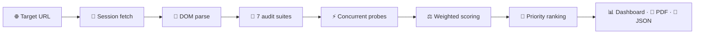

# 🔍 RankPilot

> Data-driven SEO & technical website auditor. Deterministic scoring engine, concurrent crawler, zero APIs, pure Python.

**🚀 Live demo:** https://rankpilot-wvugccwcscig6wdpe2pqiq.streamlit.app/


---

## ✨ Features — Enterprise Edition

| Feature | Details |
|---------|---------|
| 🔍 7-category audit | Meta, headings, images, links, performance, security, content — 25 checks |
| 🌐 Multi-page site audit | Sitemap-driven crawl — aggregate score, category averages, weakest pages |
| 💯 Deterministic scoring | 0–100 with transparent weights — no black boxes |
| ⚡ Concurrent crawler | `ThreadPoolExecutor` — link & image probes run in parallel |
| 📱 Device profiles | Desktop Chrome 128 · Mobile iPhone Safari · Googlebot |
| 🎓 Letter grades | A (90+) → F (<60), with per-category sub-scores |
| 📊 Radar analytics | Plotly polar chart + category distribution table |
| 🎯 Priority action plan | Fails ranked by weight × severity — fix what moves the needle |
| 📄 PDF export | One-click client-ready audit report (ReportLab) |
| 💾 JSON export | Raw structured data for pipelines & SEO teams |
| 🌙 Premium dark UI | Tabbed Streamlit dashboard, custom CSS |
| 🐳 Docker-ready | Dockerfile + docker-compose for one-command deploy |

---

## 🧠 The Science — how the audit engine works

RankPilot doesn't guess — it *measures*. Every audit runs the same deterministic pipeline: same URL, same score, every time. No ML black boxes, no mystery heuristics.

### Pipeline



### 1. 📡 Session-based fetching
A persistent `requests.Session` (connection pooling, real desktop User-Agent) fetches the target with a 10-second timeout. Typed error handling distinguishes SSL failures, timeouts, and DNS errors — each surfaces as a clear message, never a traceback. Non-HTML responses are rejected *before* parsing, so a PDF link never produces a garbage audit.

### 2. 🔬 Single-parse DOM
BeautifulSoup + `lxml` builds the document tree **once**. All seven audit suites read from that same tree — no re-fetching, no re-parsing, no wasted work.

### 3. 🧪 The seven audit suites — 25 checks
Each check is a pure function returning `earned / maximum` points, a finding, and a concrete recommendation:

- **Meta & Head (20 pts)** — title 30–60 chars, meta description 120–160 chars, viewport, charset, Open Graph trio, canonical URL
- **Headings (15 pts)** — exactly one H1, no skipped levels, non-empty headings, H1 20–70 chars
- **Images (15 pts)** — alt-text coverage, explicit width/height (kills Cumulative Layout Shift), file weight < 1MB via lightweight HEAD probes
- **Links (15 pts)** — broken-link scan with HEAD→GET fallback for CDN-blocked HEADs, anchor-text quality, `rel="noopener/nofollow"` on externals
- **Performance (15 pts)** — HTML < 100KB, external scripts ≤ 8, stylesheets ≤ 4, gzip/Brotli detection
- **Security (10 pts)** — HTTPS enforcement, mixed-content asset scan
- **Content (10 pts)** — 300+ words, H2 structure, average-sentence-length readability proxy

### 4. ⚡ Concurrency model
Link verification (up to 15 targets) and image weight probes (up to 10) run in dedicated `ThreadPoolExecutor` pools — 8 workers for links, 5 for images. What would take ~75 seconds sequentially completes in about 10. Sessions are reused across threads for connection pooling, and every streamed response is properly closed.

### 5. ⚖️ Deterministic scoring
Each check awards **full / partial / zero** credit against published thresholds — e.g. title 30–60 chars = 6 pts, present-but-off-length = 3, missing = 0. Status bands: **pass** ≥ 80%, **warn** 40–79%, **fail** < 40%. Grades map A (90+) → F (<60). The weight table is rendered in the UI next to every score — the number is fully auditable, never magic.

### 6. 🎯 Priority ranking
Every failed/warned check is ranked by `category_weight × severity` (fail = 2, warn = 1). The action plan therefore lists fixes in the order of *points recovered* — the single most valuable thing a site owner can do first.

### 7. 📱 Device profiles
Three User-Agent profiles — **Desktop Chrome 128**, **Mobile iPhone Safari**, **Googlebot** — because what users see, what phones see, and what Google sees are three different audits. Pick the lens before you scan.

---

## 🏗️ Architecture

The engine is fully decoupled from the UI — import it anywhere, no Streamlit required:

```
rankpilot/
├── app.py              → Streamlit Enterprise dashboard (UI, charts, exports)
├── core/
│   ├── __init__.py
│   ├── models.py       → AuditCheck / AuditReport / SiteAuditReport dataclasses
│   ├── engine.py       → RankPilotEngine: fetch, audit, scoring, site crawl
│   └── sitemap.py      → deterministic /sitemap.xml discovery
├── requirements.txt
├── Dockerfile
└── docker-compose.yml
```

```python
from core.engine import RankPilotEngine

# Single page
report = RankPilotEngine().inspect_url("https://example.com")
print(report.total_score, report.letter_grade)   # 70.5 C

# Full site — crawls up to 25 pages via /sitemap.xml
site = RankPilotEngine().audit_site("https://example.com", max_pages=25)
print(site.avg_score, site.grade, site.page_count)
```

**Data flow:** `URL → RankPilotEngine.inspect_url() → AuditReport → dashboard / PDF / JSON`.
The `AuditReport` dataclass is the single source of truth — the dashboard, the PDF generator, and the JSON exporter all derive from it.

---

## 🌐 Module M1 — Multi-page site audit: the science

A single-page score tells you how one URL performs. A *site* score tells you how the whole property performs — and, more importantly, *where it bleeds*. Module M1 extends the deterministic engine from one URL to an entire sitemap without changing any scoring rule: every page is audited by the exact same 25-check pipeline, so per-page scores stay directly comparable.

### 1. 🗺️ Sitemap discovery (`core/sitemap.py`)
The crawler fetches `/sitemap.xml` and parses it as XML (with a regex fallback for malformed feeds). Sitemap **index** files are followed recursively — child sitemaps are queued and crawled breadth-first. Every discovered URL is normalized and filtered to the **same registrable domain** (subdomains and off-site URLs are dropped), deduplicated, and capped at `max_pages` (default 25). If no sitemap exists or it can't be parsed, the audit degrades gracefully to the base URL alone — the run never fails, it narrows.

### 2. 🤝 Polite concurrent crawling
Pages are dispatched to a `ThreadPoolExecutor` with **5 workers** and a **0.3 s stagger between dispatches** — fast enough to finish a 25-page site in about a minute, polite enough not to hammer the target server. Each page runs the full `inspect_url()` pipeline independently. A page that times out or errors records a **zero-score report** (`status_code=0`) and the crawl continues — one bad page never aborts the site audit. Results are re-ordered deterministically to match sitemap order, so repeated runs produce identical tables.

### 3. 📐 Aggregation statistics (`SiteAuditReport`)
Raw per-page scores are rolled up with transparent, textbook statistics — no hidden weighting:

| Metric | Definition | Why it matters |
|--------|-----------|----------------|
| **Average score** | Arithmetic mean of page scores | The headline site grade |
| **Median score** | Middle value of sorted page scores | Robust against one terrible outlier page dragging the mean |
| **Category averages** | Mean of each category's % across pages | Shows *systemic* weaknesses (e.g. every page fails Images) vs isolated ones |
| **Weakest pages** | Bottom 5 pages by score | The prioritized fix-list — where remediation effort pays off first |

The site grade reuses the identical A–F scale as single-page audits, so a site's `72.4/C` means exactly what a page's `72.4/C` means.

### When to use which mode
- **Single page** — deep-dive on one URL: full 25-check matrix, radar chart, per-check action plan.
- **Full site** — triage across the property: aggregate health, category-wide patterns, weakest-page ranking, one-page executive PDF for stakeholders.
- **Compare** — benchmark against a competitor: side-by-side audits, score deltas, and a prioritized fix-list.

---

## 🆚 Module M2 — Competitor comparison: the science

Knowing your own score is half the picture. Module M2 audits two sites with the **identical deterministic pipeline** — same 25 checks, same weights, same thresholds — so every delta is apples-to-apples, never an artifact of different scoring.

### 1. 🔬 Per-check normalization (`core/compare.py`)
Each check earns raw points against its own weight (2–8 pts), so cross-site comparison normalizes every check to a 0–100 scale: `(avg_earned / maximum) × 100`. Pages that failed to crawl contribute **0** to check averages — exactly as they contribute 0 to the headline site average — so the comparison table can never look rosier than the site score it summarizes.

### 2. 📊 Deltas, not just scores
- **Score deltas** (average and median): positive means you lead, negative means you trail.
- **Category deltas**: per-category percentage-point gaps, charted as diverging bars.
- **Check table**: every check side-by-side with win / lose / tie verdicts (tie = gap under 2 points, the noise floor).

### 3. 🎯 Priority opportunities
The money output: checks where the competitor scores pass/warn and you fail, ranked by gap size. This is the ordered fix-list — the smallest set of changes that closes the competitive distance fastest. Failed competitor crawls never abort your audit; they surface a clear, human-readable warning instead.

### 4. 📄 Comparison PDF
A capped two-page executive PDF: score summary, category deltas, and the ranked opportunity list with per-check recommendations.

**Data flow:** `URL × 2 → audit_site() × 2 → compare_reports() → ComparisonReport → dashboard / PDF`. The `ComparisonReport` dataclass is the single source of truth — pure computation, zero network I/O, fully deterministic.

---

## 🕰️ Project evolution — from first audit to competitive intelligence

RankPilot was built incrementally, one verified module at a time. Every stage kept the same contract: **deterministic scoring, no silent behavior changes, no black boxes.**

**v1.0 — The engine (Oct 10, 2026).** It started as a single-page technical auditor: a persistent-session fetcher, one BeautifulSoup parse shared by all suites, and 25 weighted checks across 7 categories producing a 0–100 score and an A–F grade. The founding bet was *measurement over guessing* — the same URL must produce the same score on every run. Shipped with a dark Streamlit dashboard, Plotly radar analytics, a priority action plan, one-click PDF/JSON export, Docker support, and a live demo.

**v1.1 — Reliability & correctness (Oct 11–12).** Real-world crawling exposed two flaws, both fixed transparently: a manual `Accept-Encoding` header was breaking decompression and deflating scores (removed — true scores restored), and slow hosts needed a 30 s timeout with retry. No scoring rule changed; the numbers just became honest.

**v2.0 — Module M1: full-site audits (Oct 13).** One page tells you how a URL performs; a *site* score tells you where the property bleeds. Added deterministic sitemap discovery (index files followed recursively, same-domain filtering, capped pages), polite concurrent crawling (5 workers, staggered dispatch), and transparent aggregation — mean, median, category averages, weakest-5 pages — on the identical A–F scale. Failed pages record zeros instead of aborting the run.

**v2.1 — Module M2: competitor comparison (Oct 16).** The current release. Two sites audited through the identical pipeline, normalized per-check to 0–100, with score/category deltas, win/lose/tie verdicts, and a ranked opportunity list — the smallest set of fixes that closes the competitive gap fastest. Failed pages count as zero everywhere, so deltas can never flatter.

Full version-by-version detail lives in [CHANGELOG.md](CHANGELOG.md).

---

## ⚡ Performance

| Technique | Effect |
|-----------|--------|
| `ThreadPoolExecutor` (8 workers) | Link health checks run concurrently |
| `ThreadPoolExecutor` (5 workers) | Image weight probes run concurrently |
| Session reuse | One `requests.Session` per audit — connection pooling |
| Bounded sampling | ≤15 links, ≤10 images, 10s fetch timeout |

Typical full audit: **seconds, not minutes**.

---

## 🛠️ Tech stack

- **Python 3.11** — core language
- **Streamlit** — dashboard UI
- **Requests** — HTTP fetching & concurrent probing
- **BeautifulSoup4 + lxml** — HTML parsing
- **Plotly** — radar-chart analytics
- **ReportLab** — PDF report generation
- **Docker** — containerized deployment

## 🚀 Run it

```bash
pip install -r requirements.txt
streamlit run app.py
```

Or with Docker:

```bash
docker compose up -d --build
# open http://localhost:8501
```

## ☁️ Cloud deploy

One-click deploy on [Streamlit Community Cloud](https://streamlit.io/cloud) —
connect the repo and set `app.py` as the entry point.

## 🔮 Roadmap

- [x] Sitemap-aware multi-page crawl (Module M1 — shipped)
- [ ] Core Web Vitals via PageSpeed API (optional key)
- [ ] Historical tracking — re-audit and diff scores over time
- [ ] Scheduled audits with email digests

---

<p align="center">RankPilot — data-driven SEO audits 🔍</p>
